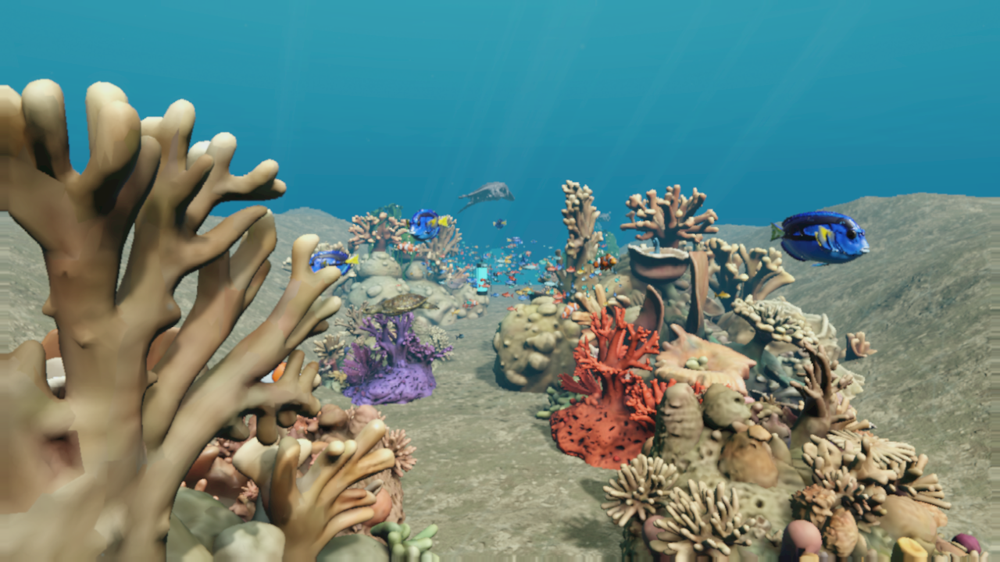
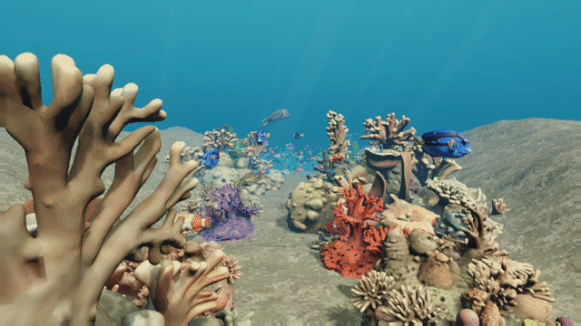
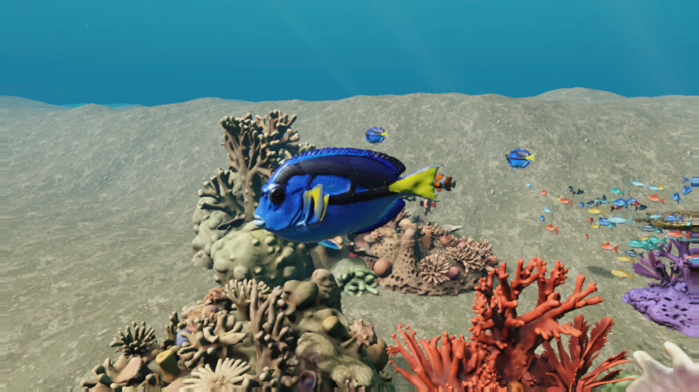
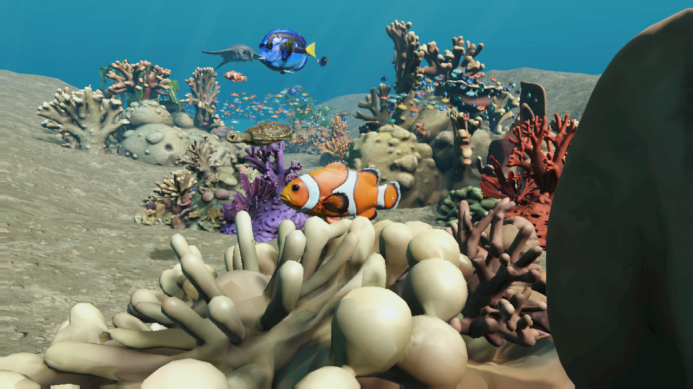
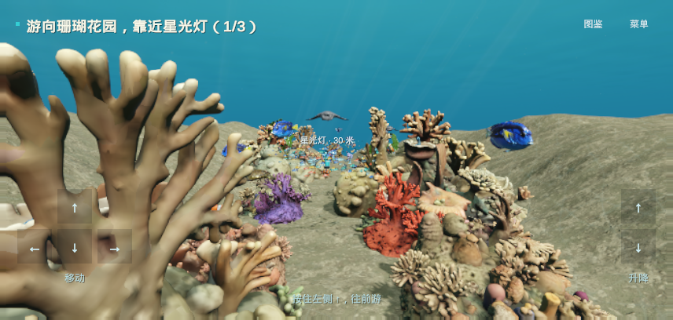

# 海底世界 · The Blue Between Worlds

沿着珊瑚水道游动，跟随鱼群点亮星光灯，或帮被渔网缠住的小海龟重返水面。

**Unity 6 · URP · WebGL · 中文剧情 · 四种可选角色**



## 先看一段海底漫游

[](docs/media/underwater-showcase.mp4)

**▶ [观看 8 秒 MP4 展示](docs/media/underwater-showcase.mp4)** · [下载 MP4](docs/media/underwater-showcase.mp4?raw=1)

珊瑚水道 → 蓝色鱼近景 → 座头鲸 → 渔网救援场景。

视频由当前 Unity 场景逐帧录制，采用编排镜头，无声；不是手动通关录像，也不代表浏览器或核显实测帧率。[素材与录制说明](docs/media/README.md)

## 和海洋伙伴一起探索

350 条群游小鱼穿过珊瑚水道，蓝色鱼和小丑鱼在近处游动；继续探索还能遇见海龟、魔鬼鱼、水母和座头鲸。

| 蓝色鱼 | 小丑鱼 |
| --- | --- |
|  |  |

## 走进故事，自己动手

- **探险：追着鲸歌找星光。** 跟随引导穿过珊瑚花园、水道和拱门，点亮三盏星光灯。
- **救援：送小海龟去呼吸。** 靠近被渔网缠住的海龟，拿起割网刀，划开标记处的网绳，再带它浮到水面。

可选海龟、魔鬼鱼、小丑鱼或鲸鱼角色。不同体型对应不同的穿行空间和转向手感。



页面只保留当前目标和半透明操作按钮。需要找鲸鱼时，在菜单打开定位；语音提示、背景音和对白字幕可以分别开关。

## 开始游玩

方向箭头或 **WASD** 移动，**E** 上浮、**Q** 下潜；拖动空白处看四周，滚轮调整视野。

项目使用 **Unity 6000.3.26f1**，安装 WebGL Build Support 后打开仓库根目录。模型、贴图、字体和配音已包含在项目内，无须资产生成账号。

已经构建好 WebGL 的开发者可以运行：

```bash
python3 Tools/serve_webgl.py --directory Build/WebGLReefLife --port 8904
```

然后打开 [本地试玩](http://localhost:8904/?water=layered)。当前没有公开托管的在线试玩站点；团队内网预览地址不作为公网入口。

构建命令、源码目录、完整验证方法见 [开发文档](docs/DEVELOPMENT.md)。

## 项目与资产说明

本仓库维护当前可构建的开发快照。截图与视频都来自游戏场景，不使用 AI 概念图代替实际效果；本次文档更新不改变游戏渲染或玩法。

字体与沙地纹理保留了原许可。模型和配音未附单独再分发许可，复用前请确认原始来源的授权；本仓库未声明统一开源许可。详见 [资产来源与许可](docs/DEVELOPMENT.md#asset-provenance-and-licenses)。
